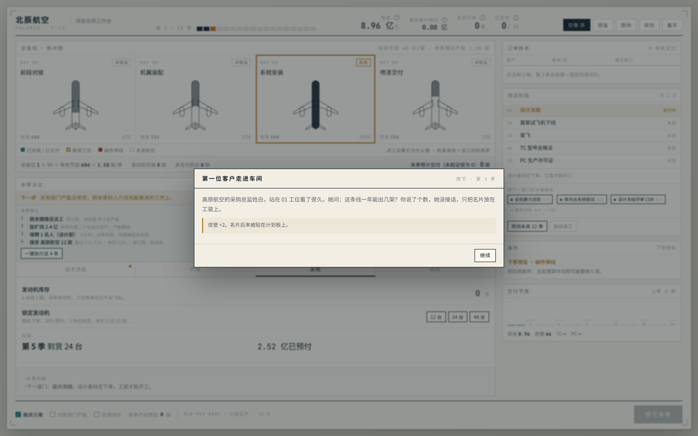
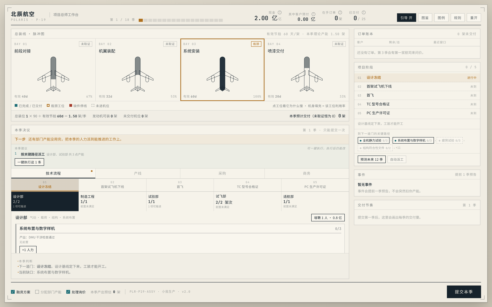
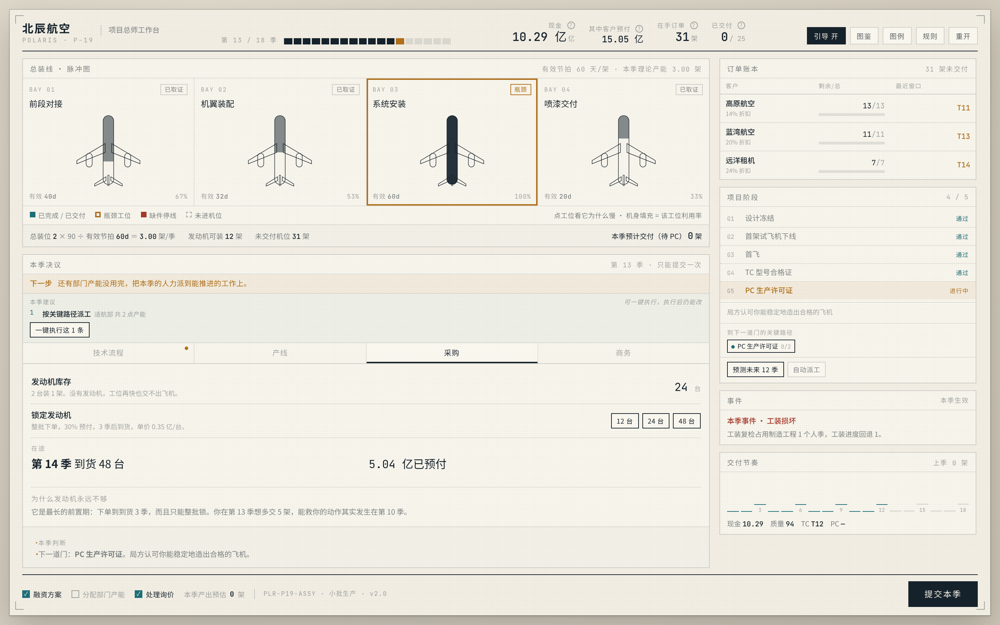
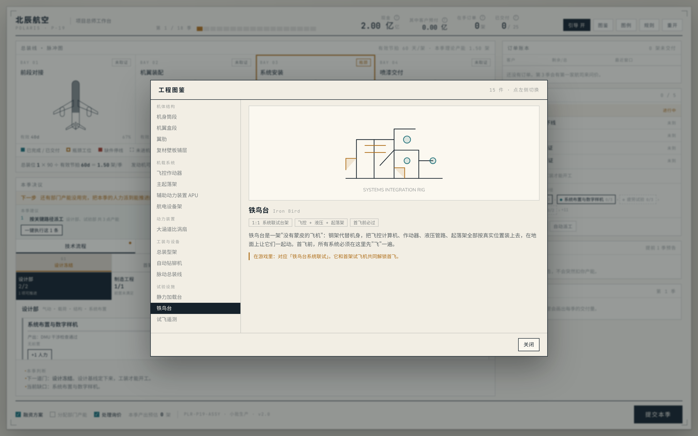
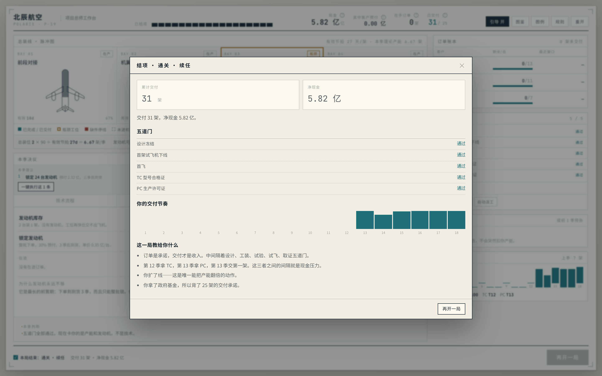

# ART_DIRECTION — 《适航》

> 输入：`GAME_DESIGN.md`、`PRODUCT_BRIEF.md`
> 本作没有 3D 世界，视觉主体是**一张会被你改动的工程图**和**一本你欠着的账**。

---

## 1. `targetFinish` 与核心视觉原则

| 项 | 规定 |
|---|---|
| `targetFinish` | **成熟商业成色**（polished commercial）。不是 graybox，不是概念海报：随手截一张主界面，应当像一款已经做完的工业经营游戏，而不是技术演示 |
| 视觉母题 | 「工程图纸 + 交付账本」：左手是技术纸，右手是财务纸，两张纸钉在同一块板子上 |
| 材质语言 | 暖白纸面、亚光、细发丝线、等宽数字、印刷网点；拒绝深色霓虹仪表盘、玻璃拟态、圆角胶囊按钮、渐变发光 |
| 唯一装饰 | 图纸标题栏（图号 / 比例 / 阶段 / 审核）与四角定位刻线 —— 它是"这是工程文件"的身份证明 |
| 色彩总量 | 4 色 + 纸底：墨黑、琥珀（风险）、青（合同/已交付）、朱红（停线） |

**审美准绳（符合 / 偏离）**

| 符合本作 | 偏离本作 |
|---|---|
| 一行数字能读出"这季能交几架"，靠对齐与字重区分主次 | 用图标和插画讲故事 |
| 停线是一条线断掉、一个短签，克制到近乎冷酷 | 全屏红色闪烁 + 震动 + 弹窗警告 |
| 飞机是图纸上的俯视线稿，只有轮廓和分段装填 | 渲染精修的三维客机 |
| 纸张有轻微印刷颗粒与压痕 | 玻璃质感、金属反光、HDR |

---

## 2. 镜头、构图与视觉语言

| 项 | 规定 |
|---|---|
| 视角 | 唯一的空间视角是**正俯视的等轴测总装线剖视**，视线垂直于车间地面，无线透视收缩（保持图纸的平行投影） |
| 机位 | 固定不可旋转、不可缩放。玩家不是在逛工厂，是在读一张图 |
| 主角 | **当前瓶颈工位**。它以更粗的描边、更深的墨色、右侧的「瓶颈」短签被标出 |
| 目标点 | 本季唯一决策卡，永远在画面中央偏下，是全屏唯一的实心色块 |
| 威胁 | 缺件停线的工位：脉冲动画停止 + 朱红描边 + 缺件名称与 ETA |
| 奖励 | 已交付栏的机位：青描边 + 累计计数跳字 |
| 地标 | 四个工位按"前段对接 → 机翼装配 → 系统安装 → 喷漆交付"从左到右固定排序，永不变位 |
| 剪影轮廓 | 飞机一律俯视线稿：机身圆角长条 + 后掠梯形机翼 + 平尾。机身长宽比按真实 110 座支线机约 3.6:1 压缩绘制 |
| 体型比例 | 工位间距 = 1.4 倍机身长；工位框高 = 1.2 倍翼展；人与设备只画为最小刻度块，不画细节 |
| 疏密 | 左侧产线占 62% 宽度，右侧账本 26%，中间留 12% 空白。空白是刻意的：它让决策卡成为唯一焦点 |

---

## 3. 服务玩法的色光、材质与动效

| 状态 | 颜色 | 材质表现 | 非颜色提示（必须同时存在） |
|---|---|---|---|
| 正常在产 | 墨黑 | 实线描边，脉冲点沿轨道匀速移动 | 脉冲点位置 = 该工位完成了本架的哪一段 |
| 瓶颈 | 墨黑加深 + 琥珀短签 | 描边加粗 2 倍 | 「瓶颈 · 60 天」文字短签 |
| 缺件停线 | 朱红 | 脉冲停止，轨道变成虚线 | 「缺件」图标 + 件名 + ETA 天数 |
| 合同/已交付 | 青 | 细实线 + 数字 | 「第 N 架」计数 |
| 逾期风险 | 琥珀 | 倒计时数字 | 「剩 N 季」短签 |

- **不依赖颜色的图形提示**：所有关键状态都配一个实心轮廓图形 + 2–3 字短签，色盲与灰度下仍可读。
- **低动效替代**：系统设置"减弱动态效果"时，脉冲点变为静态分段标记，位置信息完全保留。
- **对比度**：正文墨黑对纸底 ≥ 12:1，琥珀对纸底 ≥ 4.5:1，朱红对纸底 ≥ 5:1。
- **材质**：纸面带 3% 网点与极轻压痕；面板之间有 1px 发丝线和 1 道 4px 投影阴影，模拟"纸钉在板上"。

---

## 4. HUD 布局与操作反馈

### 4.1 首屏布局（1440×900 固定桌面）

```
┌──────────────────────────────────────────────────────────────┐
│ 顶栏：公司 · 型号 · 第 N/12 季 · 现金 · 在手 / 已交付          │
├───────────────────────────────┬──────────────────────────────┤
│ 总装线脉冲图（四工位，可点）   │ 订单账本（每行带倒计时）      │
│                               │  · 客户 / 架数 / 窗口 / 折扣  │
│  [瓶颈短签] [缺件短签]         │  · 逾期行琥珀化               │
├───────────────────────────────┤                              │
│ 本季决议卡（全屏唯一实心块）   │                              │
│  三个选项 · 各自代价与效果     │                              │
├───────────────────────────────┴──────────────────────────────┤
│ 结算摘要：本季交付 N 架 ｜ 上限由谁决定 ｜ 现金变动 +X.XX      │
└──────────────────────────────────────────────────────────────┘
```

| 项 | 规定 |
|---|---|
| 首屏重心 | 决议卡（实心纸色块 + 三行选项），视觉权重最高 |
| 信息层级 | ① 本季能不能交 ② 卡在哪 ③ 欠多少 ④ 规则细节（折叠） |
| 即时反馈 | 选项悬停即在地图上高亮受影响工位；确认后该工位动画立刻变化 |
| 失败提示 | 结算面板顶部一行朱红归因，附"追到第 N 回合的哪个决定" |
| 结算画面 | 交付数、毛利瀑布、信誉变化、未交付机位的预付款负债 |
| 字体 | 中文：思源黑体 / Noto Sans SC（400 / 500 / 700）；数字与代号：等宽字体，字距 +2%，用于所有金额、天数、架数 |
| 阅读动线 | Z 字：左上状态 → 右上账本 → 中央决议 → 底部结算 |
| 单屏字数 | 主界面 ≤ 120 字，结算面板 ≤ 300 字，单张问题单 ≤ 80 字 |
| 视口与回流 | 1440×900 是设计基准；≥1180px 用固定 1400×860 的图纸版面；561–1180px 改单列堆叠，产线俯视图换成**工位列表**，保留循环天数、瓶颈、缺件与状态短签；≤560px 进一步隐藏进度条，只留工位名与状态。产线图本身不做压缩缩放，缩到看不清就等于没有 |
| 已还原画面 | 已按本节规范实现为可运行构建，见第 5 节实机截图 |
| 文化符号边界 | 无国旗、无真实涂装、无机型剪影、无航司 logo；虚构世界的识别符号只有"色带 + 三位代号" |

### 4.2 交互反馈细则

- **点击工位** → 展开该工位近 4 季的循环天数折线与"为什么这么慢"（缺件 / 返工 / 学习曲线）。
- **点击订单行** → 展开该单的 PDP 排期表与"这架为什么晚"的三层归因：件 / 位 / 证。
- **确认动作** → 只播一次反馈：工位状态变化 + 决议卡折叠为"已执行"薄条。
- **不允许**出现二次确认弹窗；决策卡本身就是确认动作。

---

## 5. 关键游戏时刻

| # | 时刻 | 玩家操作 | 局势压力 | 画面焦点 | 操作前后画面变化 |
|---|---|---|---|---|---|
| 1 | **首架下线（T7）** | 确认"完成喷漆与交付检查" | TC 刚拿到，全公司等着这一架 | 第 4 工位从琥珀变青，机身线稿最后一段被填满 | 累计计数从 0 跳到 1，账本第一行倒计时消失，底部结算栏浮出"第 1 架交付"薄条 |
| 2 | **缺件停线（T9）** | 无操作可选，只能读归因 | 本季计划 6 架，实际只能交 2 架 | 第 3 工位脉冲停止、转朱红、出现「缺件 · 主起落架作动筒 · ETA 41 天」 | 全屏其他动画静止；账本三行同时转琥珀；结算栏出现一句"本季上限由发动机决定" |
| 3 | **问题单加试（T5）** | 把 2 支工程队从"结构疲劳"改投"飞控与航电" | 加试意味着 TC 可能推迟一季 | 工程面板新增一张盖着"必须本季处理"的卡片 | 取证进度条整体后退 1 格，TC 预计回合从 T7 变 T8 |
| 4 | **第 25 架交付（T11）** | 确认交付 | 现金 8.94 亿，账本还剩 3 架 | 累计计数跳到 25，顶栏出现"里程碑达成"细线框 | 决议卡换成"下一代机型立项"钩子；结算栏展开毛利瀑布 |

四个时刻都必须在**带完整 UI 的真实游戏画面**里成立，不能用概念海报或局部插画代替。

### 5.0 实机：序章与立项



序章沿用同一套图纸版式，但正文换成人物与场景，不加插画、不加动画——用文字的克制换代入感。

### 5.1 实机：技术流程页



主界面把"哪道门、谁在推、卡在哪"三件事放在同一屏：上方是门条，中间是部门产能，下方是当前部门的工作项卡。卡片左侧的红边表示前置未满足，玩家不用读文字就知道这条线走不通。

### 5.2 实机：取证后的空转期



这一屏是本作的核心教学画面：项目阶段四道通过、第五道进行中；总装线亮着红灯；账本上 28 架在手；交付节奏一条都没有。玩家会第一次意识到"取证"和"能交付"是两件事。

### 5.3 实机：工程图鉴



图鉴沿用同一套制图语言：细发丝线、等宽标注、工程图的辅助虚线。它是把"项目管理界面"拉回"飞机本身"的那一层，也是玩家愿意反复打开的一屏。

### 5.4 实机：结项



## 6. 声音方向

| 层 | 内容 | 说明 |
|---|---|---|
| 环境 | 车间低频嗡鸣（60–120 Hz 持续音）+ 偶尔的气动工具声 | 音量极低，作为"你在工厂里"的潜意识提示 |
| 功能音效 1 | 铆枪节拍"嗒嗒"，随脉冲点移动同步 | 玩家能靠听觉判断产线是否在动 |
| 功能音效 2 | 停线：一声短促的金属闷响后归于安静 | 用"变安静"表示出事，而不是加警报 |
| 功能音效 3 | 交付：纸张盖章声 + 印章落纸 | 与"账本"母题一致 |
| 功能音效 4 | 取证通过：单声清脆铃 | 全游戏唯一的明亮音色，稀缺所以有意义 |
| 配乐边界 | 只用极简工业脉冲与低频持续音；禁用史诗管弦、禁用励志钢琴、禁用鼓点渐强 | 情绪来自局势，不来自配乐 |
| 语音 | 不做角色配音 | 董事会备忘、客户来信、问题单都是文本 |
| 静音可玩 | 全部关键信息均有文字与图形冗余，静音与纯字幕模式下完整可玩 | 硬要求 |

---

## 7. 资产清单与视觉风险

### 7.1 必需资产

| 资产 | 用途 | 识别特征 | 可降级方案 |
|---|---|---|---|
| 四工位总装线俯视线稿 | 主界面核心 | 四个固定顺序的矩形工位 + 轨道 + 飞机俯视线稿 | 可降级为纯表格 + 状态色条 |
| 机身分段填充图 | 表达"这架做到哪一步" | 6 段机身，逐段填墨 | 可降级为 6 个方格进度 |
| 订单账本表格组件 | 商务决策 | 发丝线表格、等宽数字、倒计时列 | 不可降级，是核心 |
| 决议卡 | 每回合唯一操作 | 实心纸块 + 三行选项 + 代价副行 | 不可降级 |
| 图纸标题栏 | 身份标识 | 右下角双线框，含图号/比例/阶段/审核 | **已降级**：构建版把图号戳 `PLR-P19-ASSY · 小批生产 · v1.0` 放进页脚，独立标题栏未实现 |
| 结算面板 | 归因与学习 | 交付数、毛利瀑布、预付负债 | 可降级为纯文本行 |
| 问题单卡片 | 取证系统 | 卡片 + 盖章位 + 编号 | 可降级为列表行 |

### 7.2 版权边界

全部原创矢量与原创文本。不使用任何真实厂商 logo、涂装、机型照片、手册截图、新闻图片；飞机线稿为按公开尺寸比例重新绘制的概括图形，不做一比一还原。

### 7.3 视觉风险

| 风险 | 说明 | 缓解 |
|---|---|---|
| 信息密度过高导致"像后台管理系统" | 经营游戏最大的成色陷阱 | 用大字号、强对齐、大量留白与图纸标题栏把它拉回"设计物"而不是"后台" |
| 纸面风格在 1440 宽下显得空 | 留白过多会像未完成 | 用脉冲线、网点、压痕与短签把空白"压住" |
| 线稿飞机难以辨认 | 概括过度会像飞镖 | 固定 3.6:1 机身比例 + 明显后掠角 + 平尾与发动机吊挂位置 |
| 状态色在灰度下失效 | 无障碍硬要求 | 每个状态必须有图形与文字冗余 |

---

## 8. 交付前的视口核查

在 1440×900 下逐项确认，结论如下：

| 检查项 | 结论 | 依据 |
|---|---|---|
| 四个工位同屏可见、顺序不变、瓶颈可指 | 通过 | 四工位横向固定排布，03 工位以 2px 朱红描边 + 「瓶颈」短签双重标注 |
| 停线在不读文字时也能看出 | 通过 | 脉冲线变为虚线并断开、机身降为 55% 墨度、叠加红色叉标 |
| 账本倒计时比客户名更醒目 | 通过 | 倒计时为等宽数字且临近时转琥珀，客户名降为 11px 常规字重 |
| 决议卡是唯一焦点 | 通过 | 全屏唯一的实心纸色块 + 唯一 1px 墨黑外框 |
| 单屏中文字数 | 通过 | 主界面约 110 字，结算屏约 210 字 |
| 灰度下可区分三态 | 通过 | 三态分别用实线／加粗描边／虚线 + 文字短签区分，不依赖色相 |

两处已知取舍：产线图在超宽比例下面板上下各留约 40px 余量，用于放尺寸线与刻度；结算屏的瀑布图在 860 高下会上下居中留白，由底部成本构成条补齐信息密度。

回流另在 430px 与 900px 两个宽度下实测：430px 时工位列表逐行可读、决议卡纵向展开、账本与结算完整保留；900px 时决议卡回到三列、工位行显示进度条。两种宽度下都没有出现文字被压缩到不可读的情况 —— 这是"缩成一团"这类问题的判定线：**宁可换一种表达，也不整屏缩放。**
